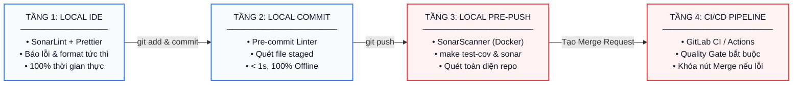

# Quy Trình Chuẩn Hóa Phân Tích Chất Lượng Code với SonarQube (Enterprise Quality Gate)

Tài liệu này chuẩn hóa quy trình phân tích mã nguồn tĩnh (Static Application Security Testing - SAST & Code Quality) cho hệ thống **Enterprise NestJS Multi-Tenant Backend**.

Mục tiêu cốt lõi: **Đảm bảo 100% mã nguồn đáp ứng tiêu chuẩn nghiêm ngặt về bảo mật, độ tin cậy và hiệu năng mà không làm giảm tốc độ phát triển hàng ngày của lập trình viên (Developer Experience - DX).**

---

## 🏛️ I. Tổng Quan Chiến Lược 4 Tầng Kiểm Soát Chất Lượng (4-Tier Quality Gate)

Hệ thống phân tầng kiểm soát chất lượng theo 4 chốt chặn nối tiếp nhau trong vòng đời phát triển:



### Bảng đối chiếu 4 tầng kiểm soát:

| Tầng  | Tên chốt chặn      | Công cụ áp dụng                  | Thời điểm kích hoạt                          | Tốc độ          | Tính bắt buộc                           |
| :---: | :----------------- | :------------------------------- | :------------------------------------------- | :-------------- | :-------------------------------------- |
| **1** | **Local IDE**      | SonarLint + Prettier             | Khi đang gõ code & bấm Lưu (`Ctrl + S`)      | Tức thì (0s)    | Khuyến nghị cho cả team                 |
| **2** | **Local Commit**   | Git Pre-commit (Husky / Linter)  | Khi gõ lệnh `git commit`                     | Siêu tốc (< 1s) | Bắt buộc tại máy                        |
| **3** | **Local Pre-Push** | SonarScanner (Docker / Makefile) | Trước khi gõ `git push`                      | ~30s            | Tùy chọn (On-Demand)                    |
| **4** | **CI/CD Pipeline** | GitLab CI / GitHub Actions       | Khi tạo Merge Request / Push vào nhánh chính | 1–2 phút        | **Bắt buộc tuyệt đối (Chốt chặn cuối)** |

---

## 💻 II. TẦNG 1: Local IDE (SonarLint & Prettier Auto-Format)

> **Mục tiêu**: Bắt lỗi và định dạng chuẩn ngay khi ngón tay bạn chạm vào bàn phím, loại bỏ 90% lỗi cơ bản trước khi đưa code vào Git.

### 1. Cài đặt Extensions trên VSCode:

Vào mục Extensions (`Ctrl + Shift + X`) tìm và cài đặt 2 extension:

- **Prettier - Code formatter** (`esbenp.prettier-vscode`): Tự động format code theo chuẩn chung.
- **SonarLint** (`SonarSource.sonarlint-vscode`): Bắt lỗi code smell, bảo mật tức thì.

_(Dự án đã có sẵn file [.vscode/extensions.json](file:///be-nestjs-multi-tenant/.vscode/extensions.json), khi mở VSCode sẽ tự động gợi ý cài đặt)_.

### 2. Cấu hình thiết lập tại [.vscode/settings.json](file:///be-nestjs-multi-tenant/.vscode/settings.json):

```json
{
  "typescript.preferences.importModuleSpecifier": "non-relative",
  "javascript.preferences.importModuleSpecifier": "non-relative",
  "typescript.preferences.importModuleSpecifierEnding": "minimal",
  "javascript.preferences.importModuleSpecifierEnding": "minimal",
  "typescript.suggest.paths": true,
  "javascript.suggest.paths": true,

  // 1. Tự động Format code với Prettier khi lưu (Ctrl + S) - Giống 100% make format
  "editor.formatOnSave": true,
  "editor.defaultFormatter": "esbenp.prettier-vscode",
  "[typescript]": {
    "editor.defaultFormatter": "esbenp.prettier-vscode",
    "editor.formatOnSave": true
  },
  "[javascript]": {
    "editor.defaultFormatter": "esbenp.prettier-vscode",
    "editor.formatOnSave": true
  },
  "[json]": {
    "editor.defaultFormatter": "esbenp.prettier-vscode",
    "editor.formatOnSave": true
  },

  // 2. Đồng bộ bộ luật (Quality Profile) từ SonarQube Server về IDE (Connected Mode)
  "sonarlint.connectedMode.connections.sonarqube": [
    {
      "connectionId": "internal-sonar",
      "serverUrl": "http://57.xxx.xx.xx",
      "token": "sqa_c741xxxxxxxxxxxxxxxxxxxx"
    }
  ],
  "sonarlint.connectedMode.project": {
    "connectionId": "internal-sonar",
    "projectKey": "NestJS-HeadlessCMS-Rule"
  }
}
```

> [!TIP]
>
> - **Lợi ích Prettier**: Bấm `Ctrl + S` là code tự chuẩn hóa thụt dòng, dấu ngoặc, dấu nháy theo đúng file [`.prettierrc`](file:///be-nestjs-multi-tenant/.prettierrc).
> - **Lợi ích SonarLint Connected Mode**: Tải toàn bộ ruleset của dự án từ `http://57.xxx.xx.xx` về máy, gõ đến đâu gạch đỏ cảnh báo đến đấy, loại bỏ hoàn toàn tình trạng "ở máy tôi chạy được mà lên server bị báo lỗi".

---

## ⚡ III. TẦNG 2: Local Commit (Pre-Commit Gate)

> **Mục tiêu**: Chặn các lỗi cú pháp, linting trên các file vừa sửa mà không làm chậm nhịp gõ commit hàng ngày (< 1 giây, hoàn toàn offline).

### 1. Hành vi trong luồng Git hàng ngày:

```bash
# 1. Đưa file vào staging area (diễn ra tức thì 0.01s, không quét)
git add src/modules/auth/auth.service.ts

# 2. Tạo commit (chỉ mất ~0.5s - 1s kiểm tra cú pháp nội bộ)
git commit -m "feat(auth): add multi-tenant token verification"
```

- **`git add <file>`**: Chỉ đưa file vào Staging Area, tuyệt đối KHÔNG chạy phân tích nặng, không làm chậm thao tác.
- **`git commit`**: Kích hoạt kiểm tra cục bộ offline (như `oxlint`, `prettier`) trên chính các file staged.

### 2. Cách bỏ qua kiểm tra khi cần commit gấp (Bypass với `--no-verify`):

Khi cần commit lưu tạm code đang làm dở (WIP - Work in Progress) trước khi đổi máy hoặc chuyển nhánh:

```bash
# Cách 1: Dùng cờ đầy đủ
git commit -m "WIP: lưu tạm code đang làm dở" --no-verify

# Cách 2: Dùng cờ viết tắt (-n)
git commit -n -m "WIP: lưu tạm code đang làm dở"
```

> [!NOTE]
> Cờ `--no-verify` (hoặc `-n`) chỉ có tác dụng vượt qua chốt chặn ở máy cá nhân của bạn. Khi bạn đẩy code lên và mở **Merge Request**, hệ thống **CI/CD Quality Gate trên Server (Tầng 4)** vẫn sẽ tự động quét để đảm bảo nhánh chính không bị lỗi.

---

## 🚀 IV. TẦNG 3: Local Pre-Push (SonarScanner & Quality Gate On-Demand)

> **Mục tiêu**: Chạy phân tích toàn diện mã nguồn cùng báo cáo độ bao phủ kiểm thử (Test Coverage) trước khi đẩy code rời khỏi máy cá nhân.

### 1. Cấu hình tập trung tại [sonar-project.properties](file:///be-nestjs-multi-tenant/sonar-project.properties):

Toàn bộ thông số phân tích của dự án được khai báo tập trung tại file cấu hình ở thư mục gốc:

```properties
# Server & Định danh dự án
sonar.host.url=http://57.xxx.xx.xx
sonar.projectKey=NestJS-HeadlessCMS-Rule
sonar.projectName=Enterprise NestJS Multi-Tenant Backend
sonar.projectVersion=1.0.0

# Thư mục mã nguồn & Thư mục kiểm thử
sonar.sources=src
sonar.tests=test,src
sonar.test.inclusions=**/*.spec.ts,**/*.test.ts,test/**/*.ts

# Danh sách loại trừ (Không quét code tự sinh và dependencies)
sonar.exclusions=**/node_modules/**,**/dist/**,**/coverage/**,**/docker/**,**/*.config.*,src/main.ts,prisma/**

# Báo cáo Code Coverage từ Vitest
sonar.javascript.lcov.reportPaths=coverage/lcov.info

# Bảng mã
sonar.sourceEncoding=UTF-8
```

### 2. Thực thi kiểm tra thủ công (On-Demand) qua Docker / Makefile:

Dự án đã đóng gói sẵn lệnh quét SonarQube qua **Docker** trong [Makefile](file:///be-nestjs-multi-tenant/Makefile). Lập trình viên không cần cài đặt Java hay cấu hình CLI phức tạp lên máy cá nhân.

#### Đoạn cấu hình trong [Makefile](file:///be-nestjs-multi-tenant/Makefile):

```makefile
# ------------------------------------------------------------------------------
# SonarQube Static Code Analysis (Docker-based)
# ------------------------------------------------------------------------------
SONAR_HOST_URL ?= http://57.xxx.xx.xx
SONAR_TOKEN    ?= sqa_c741xxxxxxxxxxxxxxxxxxxx

sonar: ## Run SonarQube analysis via Docker (usage: make sonar SONAR_TOKEN=xxx)
	@echo "$(CYAN)Running SonarScanner analysis via Docker...$(RESET)"
	docker run --rm \
		--network=host \
		-e SONAR_HOST_URL="$(SONAR_HOST_URL)" \
		-e SONAR_TOKEN="$(SONAR_TOKEN)" \
		-v "$$(pwd):/usr/src" \
		sonarsource/sonar-scanner-cli
```

#### Giải thích cơ chế hoạt động của lệnh Docker:

- `docker run --rm`: Khởi chạy container tạm thời và tự động xóa container ngay sau khi phân tích xong để tránh rác ổ cứng.
- `--network=host`: Dùng chung stack mạng của máy host để kết nối thẳng tới server SonarQube mà không bị rào cản mạng nội bộ/VPN.
- `-e SONAR_HOST_URL`: Truyền địa chỉ máy chủ SonarQube (đọc từ biến hoặc mặc định trong Makefile).
- `-e SONAR_TOKEN`: Token xác thực quyền phân tích mã nguồn.
- `-v "$$(pwd):/usr/src"`: Mount toàn bộ thư mục mã nguồn hiện tại vào thư mục làm việc `/usr/src` bên trong container.
- `sonarsource/sonar-scanner-cli`: Image chính thức do SonarSource cung cấp, có sẵn SonarScanner CLI và Java runtime chuẩn, bảo đảm kết quả phân tích đồng nhất trên mọi hệ điều hành (macOS, Linux, Windows).

#### Các bước thực thi hàng ngày:

```bash
# Bước 1: Chạy kiểm thử xuất báo cáo độ bao phủ mã nguồn (Coverage)
make test-cov

# Bước 2: Thực thi quét SonarQube
make sonar SONAR_TOKEN=sqa_c741xxxxxxxxxxxxxxxxxxxx
```

> [!TIP]
> **Cách lưu Token để không phải gõ lại mỗi lần:**
> Thêm vào file `~/.bashrc` hoặc `~/.zshrc` trên máy của bạn:
>
> ```bash
> export SONAR_TOKEN="sqa_c741xxxxxxxxxxxxxxxxxxxx"
> ```
>
> Sau đó, mỗi khi cần kiểm tra bạn chỉ việc gõ ngắn gọn:
>
> ```bash
> make sonar
> ```

---

## 🔄 V. TẦNG 4: CI/CD Pipeline (Chốt Chặn Merge Tuyệt Đối trên Server)

> **Mục tiêu**: Chốt chặn tối cao tự động chạy trên máy chủ CI/CD khi tạo Merge Request (MR). Khóa hoàn toàn nút Merge nếu vi phạm Quality Gate.

### 1. Cấu hình Pipeline cho GitLab CI ([.gitlab-ci.yml](file:///be-nestjs-multi-tenant/.gitlab-ci.yml)):

```yaml
stages:
  - test
  - sonarqube

variables:
  SONAR_USER_HOME: '${CI_PROJECT_DIR}/.sonar'
  GIT_DEPTH: '0'

# ------------------------------------------------------------------------------
# Stage 1: Chạy Unit Tests và xuất báo cáo Code Coverage (lcov.info)
# ------------------------------------------------------------------------------
unit_tests_coverage:
  stage: test
  image: node:24-alpine
  cache:
    key: '${CI_JOB_NAME}'
    paths:
      - .pnpm-store
  before_script:
    - corepack enable
    - corepack prepare pnpm@latest --activate
    - pnpm config set store-dir .pnpm-store
  script:
    - pnpm install --frozen-lockfile
    - pnpm run test:cov
  artifacts:
    expire_in: 1 day
    paths:
      - coverage/
  rules:
    - if: $CI_PIPELINE_SOURCE == 'merge_request_event'
    - if: $CI_COMMIT_BRANCH == 'master'
    - if: $CI_COMMIT_BRANCH == 'develop'

# ------------------------------------------------------------------------------
# Stage 2: SonarQube Quality Gate chốt chặn (Bắt buộc PASSED mới cho Merge)
# ------------------------------------------------------------------------------
sonarqube_quality_gate:
  stage: sonarqube
  image:
    name: sonarsource/sonar-scanner-cli:latest
    entrypoint: ['']
  cache:
    key: '${CI_JOB_NAME}'
    paths:
      - .sonar/cache
  dependencies:
    - unit_tests_coverage
  script:
    - sonar-scanner \
      -Dsonar.host.url="http://57.xxx.xx.xx" \
      -Dsonar.token="${SONAR_TOKEN}" \
      -Dsonar.projectKey="NestJS-HeadlessCMS-Rule" \
      -Dsonar.qualitygate.wait=true \
      -Dsonar.qualitygate.timeout=300
  rules:
    - if: $CI_PIPELINE_SOURCE == 'merge_request_event'
    - if: $CI_COMMIT_BRANCH == 'master'
    - if: $CI_COMMIT_BRANCH == 'develop'
  allow_failure: false
```

### 2. Kích hoạt khóa nút Merge trên giao diện GitLab:

1. **Lưu Token bí mật**: Vào GitLab $\rightarrow$ **Settings** $\rightarrow$ **CI/CD** $\rightarrow$ **Variables** $\rightarrow$ Thêm biến `SONAR_TOKEN` (chọn kiểu _Masked_).
2. **Khóa Merge khi Pipeline trượt**: Vào **Settings** $\rightarrow$ **Merge Requests** $\rightarrow$ Tích chọn ✅ **Pipelines must succeed**.

---

### 3. Cơ Chế Xử Lý Ngoại Lệ Linh Hoạt (Tránh Khóa Merge Cứng Nhắc)

Trong thực tế dự án, việc **khóa cứng 100% nút Merge** khi có bất kỳ cảnh báo nào từ SonarQube có thể quá khắt khe và gây nghẽn tiến độ phát hành (đặc biệt khi cần triển khai Hotfix gấp hoặc gặp các cảnh báo nhỏ không ảnh hưởng logic). Hệ thống áp dụng 3 cơ chế linh hoạt sau:

#### a. Quyền ghi đè của Tech Lead (Maintainer Override — _Khuyên dùng_)

- **Lập trình viên thông thường**: Nút Merge bị khóa nếu SonarQube báo FAILED nhằm ngăn ngừa rủi ro vô tình đưa code lỗi vào nhánh chính.
- **Tech Lead / Maintainer**: Có thẩm quyền bấm **"Merge anyway"** (Ghi đè thủ công). Sau khi Tech Lead đã review và xác nhận đây là case chấp nhận được hoặc là bản vá khẩn cấp, Lead có toàn quyền duyệt merge mà không bị hệ thống chặn.

#### b. Đánh dấu ngoại lệ trên SonarQube (False Positive / Won't Fix)

Nếu SonarQube phân tích nhầm (báo lỗi sai) hoặc đoạn code đó team chủ đích viết như vậy:

1. Đăng nhập giao diện web SonarQube `http://57.xxx.xx.xx`.
2. Mở issue bị báo lỗi, chuyển trạng thái sang:
   - **False Positive**: Xác nhận SonarQube báo lỗi sai.
   - **Accept / Won't Fix**: Đội ngũ đã nắm rõ và chấp nhận rủi ro này.
3. Ngay lập tức, SonarQube sẽ loại trừ issue đó $\rightarrow$ Quality Gate tự động chuyển từ **FAILED sang PASSED** $\rightarrow$ GitLab tự động mở khóa nút Merge mà không cần sửa code.

#### c. Tùy chọn chế độ cảnh báo không khóa Merge (Non-blocking Gate)

Nếu team ưu tiên tính linh hoạt tối đa và trao trọn quyền quyết định cho Reviewer:

- Trong file [.gitlab-ci.yml](file:///be-nestjs-multi-tenant/.gitlab-ci.yml), đặt:
  ```yaml
  sonarqube_quality_gate:
    ...
    allow_failure: true  # Vẫn quét và in danh sách lỗi lên MR, nhưng KHÔNG khóa nút Merge
  ```
- Khi đó, SonarQube đóng vai trò như một reviewer tự động cung cấp thông tin cảnh báo, quyền quyết định gộp code hoàn toàn do Tech Lead và Reviewer bấm chọn.

---

## 🎯 VI. Tiêu Chuẩn Nghiệm Thu Chất Lượng (Quality Gate Policy)

Mọi Pull Request / Merge Request vào nhánh `develop` hoặc `master` được đánh giá theo tiêu chuẩn phân tầng (chỉ chặn cứng lỗi nghiêm trọng, linh hoạt với các cảnh báo phụ):

| Phân nhóm tiêu chí                   | Chỉ số cụ thể                         | Ngưỡng yêu cầu            | Mức độ nghiêm trọng | Hành động                   |
| :----------------------------------- | :------------------------------------ | :------------------------ | :------------------ | :-------------------------- |
| **Lỗi nghiêm trọng (Chặn cứng)**     | **Bugs (Lỗi logic)**                  | **0 Blocker, 0 Critical** | Cao nhất            | **Khóa Merge bắt buộc**     |
|                                      | **Vulnerabilities (Lỗ hổng bảo mật)** | **0 vấn đề**              | Cao nhất            | **Khóa Merge bắt buộc**     |
| **Cảnh báo cần xem xét (Linh hoạt)** | **Security Hotspots**                 | **100% được review**      | Nghiêm ngặt         | Tech Lead xác nhận an toàn  |
|                                      | **Code Smells**                       | **Xếp hạng A** (Nợ < 5%)  | Trung bình          | Cho phép cải tiến dần       |
|                                      | **Coverage Code Mới**                 | **>= 80.0%**              | Cao                 | Linh hoạt nếu logic đặc thù |
|                                      | **Trùng lặp code (Duplications)**     | **< 3.0%**                | Trung bình          | Khuyến khích refactor       |

---

## ❓ VII. Xử Lý Sự Cố Thường Gặp (Troubleshooting)

### 1. Lỗi: `You're not authorized to analyze this project`

- **Nguyên nhân**: Token `SONAR_TOKEN` bị sai, hết hạn hoặc tài khoản chưa có quyền `Execute Analysis` trên Project Key `NestJS-HeadlessCMS-Rule`.
- **Khắc phục**: Đăng nhập `http://57.xxx.xx.xx` $\rightarrow$ `My Account` $\rightarrow$ `Security` $\rightarrow$ Tạo User Token mới.

### 2. Lỗi: `Cannot find coverage report / lcov.info`

- **Nguyên nhân**: File báo cáo kiểm thử chưa được sinh ra trước khi chạy scanner.
- **Khắc phục**: Luôn chạy `make test-cov` (hoặc `pnpm run test:cov`) trước khi chạy `make sonar`.

### 3. Lỗi: `Connection timed out` hoặc không kết nối được Sonar Server

- **Nguyên nhân**: Máy tính chưa kết nối mạng nội bộ hoặc VPN của công ty.
- **Khắc phục**: Kiểm tra kết nối mạng tới server: `curl -I http://57.xxx.xx.xx`.

### 4. Quy trình xử lý khẩn cấp (Hotfix Bypass Protocol)

- Trong trường hợp khẩn cấp (P0 Incident) cần deploy bản vá gấp mà server SonarQube gặp sự cố:
  - Lập trình viên phải ghi rõ mã Ticket Hotfix trong nội dung Commit/MR.
  - Cần có sự phê duyệt trực tiếp (Approved) từ **Tech Lead / Security Officer** để tạm thời mở khóa Merge.
