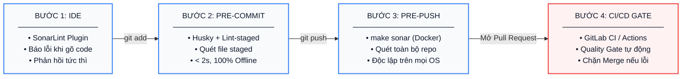

# Quy Trình Chuẩn Hóa Phân Tích Chất Lượng Code với SonarQube (Enterprise Quality Gate)

Tài liệu này chuẩn hóa quy trình phân tích mã nguồn tĩnh (Static Application Security Testing - SAST & Code Quality) cho hệ thống **Enterprise NestJS Multi-Tenant Backend**.

Mục tiêu cốt lõi: **Đảm bảo 100% mã nguồn đáp ứng tiêu chuẩn nghiêm ngặt về bảo mật, độ tin cậy và hiệu năng mà không làm giảm tốc độ phát triển hàng ngày của lập trình viên (Developer Experience - DX).**

---

## 🏛️ I. Chiến Lược 4 Tầng Kiểm Soát Chất Lượng (4-Tier Quality Gate)

Thay vì chạy phân tích nặng trực tiếp ở Git `pre-commit` (khiến mỗi lần commit mất 1–2 phút và phụ thuộc mạng), hệ thống áp dụng chiến lược phân tầng chuẩn Enterprise:



1. **Tầng 1 (Local IDE)**: Cài đặt **SonarLint** trên VSCode / WebStorm để phát hiện lỗi ngay trong lúc viết code.
2. **Tầng 2: Local Pre-commit (Husky + Lint-staged < 2s, 100% Offline)**: Chạy linter siêu tốc (`make lint`, `make format`) kiểm tra cú pháp và định dạng trên các file staged. Không gọi qua mạng, không làm chậm commit.
3. **Tầng 3 (Local On-Demand)**: Lập trình viên chạy `make sonar` để quét toàn bộ trước khi push code hoặc mở Pull Request. Chạy qua **Docker**, không cần cài Java, không cần `sudo`, hoạt động đồng nhất trên macOS, Linux và Windows.
4. **Tầng 4 (CI/CD Pipeline)**: Quality Gate tự động trên GitLab CI / GitHub Actions khi tạo Pull Request vào nhánh `develop` hoặc `master`.

---

## ⚙️ II. Cấu Hình Chuẩn Hóa (Configuration as Code)

Toàn bộ thông số phân tích được khai báo tập trung tại [sonar-project.properties](file:///home/ubuntu/learn/multi-tenant/be-nestjs-multi-tenant/sonar-project.properties) nằm ở thư mục gốc của repo:

```properties
# Server & Định danh dự án
sonar.host.url=http://57.180.31.107:9000
sonar.projectKey=be-nestjs-multi-tenant
sonar.projectName=Enterprise NestJS Multi-Tenant Backend
sonar.projectVersion=1.0.0

# Thư mục mã nguồn & Thư mục kiểm thử
sonar.sources=src
sonar.tests=test,src
sonar.test.inclusions=**/*.spec.ts,**/*.test.ts,test/**/*.ts

# Danh sách loại trừ (Không quét code tự sinh và dependencies)
sonar.exclusions=**/node_modules/**,**/dist/**,**/coverage/**,**/docker/**,**/*.config.*,src/main.ts,prisma/**

# Báo cáo Code Coverage từ Vitest
sonar.javascript.lcov.reportPaths=coverage/lcov.info

# Bảng mã
sonar.sourceEncoding=UTF-8
```

---

## 🚀 III. Hướng Dẫn Sử Dụng Hàng Ngày Cho Lập Trình Viên

### 1. Hành vi tại từng bước trong vòng đời Git (Git Lifecycle)

| Lệnh Git             | Điều gì diễn ra?                                                                                                                                                      | Tốc độ              | Phụ thuộc mạng?          |
| :------------------- | :-------------------------------------------------------------------------------------------------------------------------------------------------------------------- | :------------------ | :----------------------- |
| **`git add <file>`** | **Chỉ đưa file vào Staging Area**. Tuyệt đối KHÔNG chạy SonarScanner, KHÔNG chặn hay làm chậm thao tác. Các file này trở thành đầu vào để linter kiểm tra ở bước sau. | **Tức thì (0.01s)** | **Không (100% Offline)** |
| **`git commit`**     | Kích hoạt kiểm tra Linting & Formatting cục bộ (`make lint`) trên chính các file vừa `git add`.                                                                       | **Siêu tốc (< 2s)** | **Không (100% Offline)** |
| **`git push`**       | Đẩy code đã kiểm tra lên remote branch.                                                                                                                               | Bình thường         | Có                       |
| **Tạo Pull Request** | **CI/CD tự động kích hoạt SonarQube Quality Gate** trên server để phân tích toàn diện.                                                                                | Tự động trên CI     | Có                       |

#### Thao tác commit thông thường:

```bash
# 1. Đưa file vào staging area (diễn ra tức thì, không bị quét)
git add src/modules/auth/auth.service.ts

# 2. Tạo commit (chỉ mất ~1-2s kiểm tra lint nội bộ)
git commit -m "feat(auth): add multi-tenant token verification"
```

#### Cách bỏ qua kiểm tra khi cần commit gấp (Bypass với `--no-verify`):

Trong trường hợp cần lưu tạm code đang làm dở (WIP - Work in Progress) trước khi đổi máy/chuyển branch, hoặc commit khẩn cấp mà không muốn chạy kiểm tra:

```bash
# Cách 1: Dùng cờ đầy đủ
git commit -m "WIP: lưu tạm code đang làm dở" --no-verify

# Cách 2: Dùng cờ viết tắt (-n)
git commit -n -m "WIP: lưu tạm code đang làm dở"

# Áp dụng tương tự khi cần push gấp (bỏ qua pre-push hook):
git push origin feature-branch --no-verify
```

> [!NOTE]
>
> - Cờ `--no-verify` (hoặc `-n`) sẽ vượt qua toàn bộ Git Hooks trên máy cá nhân của bạn để tạo commit ngay tức thì.
> - **Lưu ý**: Cờ này chỉ có tác dụng cục bộ. Khi bạn đẩy code lên và mở **Pull Request**, hệ thống **CI/CD Quality Gate trên Server** vẫn sẽ tự động quét để đảm bảo nhánh chính không bị lỗi.

---

### 2. Quét SonarQube trước khi Push Code / Mở Pull Request

Dự án đã tích hợp sẵn lệnh quét SonarQube đóng gói qua **Docker** trong [Makefile](file:///home/ubuntu/learn/multi-tenant/be-nestjs-multi-tenant/Makefile).

#### Bước 1: Chạy kiểm thử xuất báo cáo độ bao phủ mã nguồn (Coverage)

```bash
make test-cov
```

Lệnh này sẽ sinh file `coverage/lcov.info` để SonarQube phân tích tỷ lệ test coverage.

#### Bước 2: Thực thi quét SonarQube

```bash
make sonar SONAR_TOKEN=sqp_xxxxxxxxxxxxxxxxxxxxxxxxxxxxxxxx
```

> [!TIP]
> **Cách lưu Token để không phải gõ lại mỗi lần:**
> Thêm vào file `~/.bashrc` hoặc `~/.zshrc` trên máy của bạn:
>
> ```bash
> export SONAR_TOKEN="sqp_xxxxxxxxxxxxxxxxxxxxxxxxxxxxxxxx"
> ```
>
> Sau đó mỗi lần cần quét, bạn chỉ việc gõ:
>
> ```bash
> make sonar
> ```

---

## 💻 IV. Cài Đặt SonarLint Trên IDE (Khuyến Nghị Cho Mọi Thành Viên)

Extension **SonarLint** giúp phát hiện lỗi bảo mật và code smells tức thì ngay khi bạn đang code.

### Hướng dẫn cài đặt trên VSCode:

1. Vào mục Extensions (Ctrl+Shift+X) tìm và cài đặt **SonarLint** (`SonarSource.sonarlint-vscode`).
2. Mở file cấu hình `.vscode/settings.json` trong dự án và cấu hình kết nối tới server nội bộ:

```json
{
  "sonarlint.connectedMode.connections.sonarqube": [
    {
      "connectionId": "internal-sonar",
      "serverUrl": "http://57.180.31.107:9000",
      "token": "sqp_xxxxxxxxxxxxxxxxxxxxxxxxxxxxxxxx"
    }
  ],
  "sonarlint.connectedMode.project": {
    "connectionId": "internal-sonar",
    "projectKey": "be-nestjs-multi-tenant"
  }
}
```

---

## 🔄 V. Tích Hợp Tự Động Hóa CI/CD (Pipeline Automation)

Hệ thống CI/CD đảm nhiệm vai trò chốt chặn cuối cùng (Quality Gate) trước khi mã nguồn được phép gộp vào nhánh chính.

### 1. Mẫu cấu hình cho GitLab CI (`.gitlab-ci.yml`)

```yaml
stages:
  - test
  - sonarqube

unit_test_coverage:
  stage: test
  image: node:24-alpine
  script:
    - corepack enable && corepack prepare pnpm@12.16.1 --activate
    - pnpm install --frozen-lockfile
    - pnpm run test:cov
  artifacts:
    paths:
      - coverage/
    expire_in: 1 day

sonarqube_check:
  stage: sonarqube
  image:
    name: sonarsource/sonar-scanner-cli:latest
    entrypoint: ['']
  variables:
    SONAR_USER_HOME: '${CI_PROJECT_DIR}/.sonar'
    GIT_DEPTH: '0'
  cache:
    key: '${CI_JOB_NAME}'
    paths:
      - .sonar/cache
  script:
    - sonar-scanner -Dsonar.token="${SONAR_TOKEN}"
  dependencies:
    - unit_test_coverage
  only:
    - merge_requests
    - develop
    - master
```

### 2. Mẫu cấu hình cho GitHub Actions (`.github/workflows/sonar.yml`)

```yaml
name: SonarQube Quality Gate

on:
  push:
    branches: [master, develop]
  pull_request:
    branches: [master, develop]

jobs:
  sonar:
    name: Test & SonarQube Scan
    runs-on: ubuntu-latest
    steps:
      - name: Checkout Source Code
        uses: actions/checkout@v4
        with:
          fetch-depth: 0

      - name: Setup pnpm & Node.js
        uses: pnpm/action-setup@v3
        with:
          version: 12.16.1

      - name: Install dependencies & Run Tests
        run: |
          pnpm install
          pnpm run test:cov

      - name: SonarQube Scanner
        uses: SonarSource/sonarqube-scan-action@v3
        env:
          SONAR_TOKEN: ${{ secrets.SONAR_TOKEN }}
          SONAR_HOST_URL: 'http://57.180.31.107:9000'
```

---

## 🎯 VI. Tiêu Chuẩn Nghiệm Thu Chất Lượng (Quality Gate Policy)

Mọi Pull Request / Merge Request vào nhánh `develop` hoặc `master` bắt buộc phải vượt qua các tiêu chí sau:

| Tiêu chí                              | Ngưỡng bắt buộc (Threshold)           | Mức độ nghiêm trọng | Hành động                  |
| :------------------------------------ | :------------------------------------ | :------------------ | :------------------------- |
| **Bugs (Lỗi logic)**                  | **0 Blocker, 0 Critical**             | Cao nhất            | Chặn Merge                 |
| **Vulnerabilities (Lỗ hổng bảo mật)** | **0 vấn đề**                          | Cao nhất            | Chặn Merge                 |
| **Security Hotspots**                 | **100% được review & xác nhận**       | Nghiêm ngặt         | Bắt buộc Security Review   |
| **Code Smells**                       | **Đạt xếp hạng A** (Nợ kỹ thuật < 5%) | Trung bình          | Yêu cầu refactor           |
| **Test Coverage trên Code Mới**       | **>= 80.0%**                          | Cao                 | Viết bổ sung Unit Test     |
| **Trùng lặp code (Duplications)**     | **< 3.0%**                            | Trung bình          | Tách hàm/module dùng chung |

---

## ❓ VII. Xử Lý Sự Cố Thường Gặp (Troubleshooting)

### 1. Lỗi: `You're not authorized to analyze this project`

- **Nguyên nhân**: Token `SONAR_TOKEN` bị sai, hết hạn hoặc tài khoản chưa được phân quyền `Execute Analysis` trên Project Key `be-nestjs-multi-tenant`.
- **Khắc phục**:
  1. Đăng nhập vào SonarQube: `http://57.180.31.107:9000`
  2. Vào góc trên bên phải -> `My Account` -> Tab `Security` -> Tạo một `User Token` mới.
  3. Liên hệ Quản trị viên (DevOps) nếu tài khoản của bạn chưa được cấp quyền truy cập project.

### 2. Lỗi: `Cannot find coverage report / lcov.info`

- **Nguyên nhân**: File báo cáo kiểm thử chưa được tạo trước khi quét.
- **Khắc phục**: Luôn chạy `make test-cov` trước khi chạy `make sonar`.

### 3. Lỗi: `Connection timed out` hoặc không kết nối được Sonar Server

- **Nguyên nhân**: Máy tính chưa kết nối mạng nội bộ hoặc VPN của công ty.
- **Khắc phục**: Bật VPN công ty và kiểm tra ping tới server: `ping 57.180.31.107`.

### 4. Quy trình xử lý khẩn cấp (Hotfix Bypass Protocol)

- Trong các trường hợp sự cố Production nghiêm trọng (P0 Incident) cần deploy bản vá gấp mà server SonarQube đang gặp sự cố:
  - Lập trình viên phải ghi chú rõ ràng mã Ticket Hotfix trong nội dung PR.
  - Cần có sự phê duyệt trực tiếp (Approved) từ **Tech Lead / Security Officer** để tạm thời bỏ qua Quality Gate.
